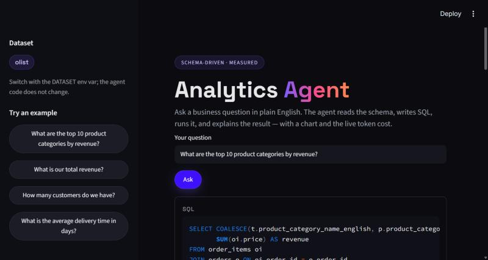
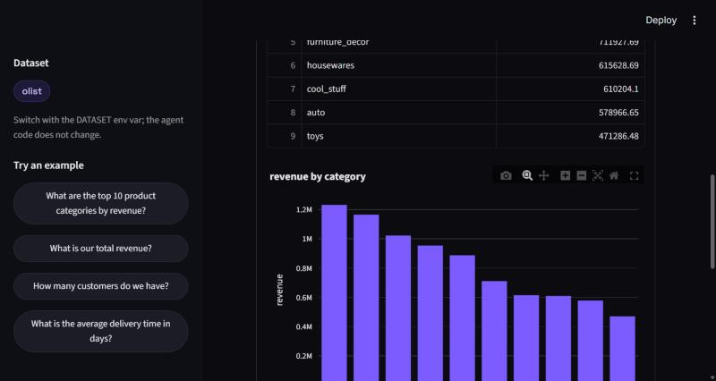

# Analytics Agent (Text-to-SQL + Insight Narrator)


Ask a business question in plain English. The agent reads the database schema at
runtime, writes DuckDB SQL, validates and runs it, and returns the answer with a
chart and a short analyst insight.

## Demo

The Streamlit UI on the Olist dataset. Ask a plain-English question; the agent
shows the SQL it wrote, the result, a chart, and a short insight, with the live
latency and token cost.





## Headline result

The same agent code, pointed at two very different domains by changing one env
var, with a semantic layer that encodes each dataset's business definitions:

| | Olist (e-commerce, 9 tables) | UPI (fintech, 1 table) |
|---|---|---|
| Accuracy, schema only (baseline) | 72.2% | 68.8% |
| **Accuracy, with semantic layer + examples** | **100.0%** | **93.8%** |
| Lift from the semantic layer | +27.8 pp | +25.0 pp |
| Hallucination rate | 0 of 18 | 0 of 16 |
| Avg latency | 2.24 s | 2.07 s |
| Cost per query | about Rs 1.48 | about Rs 0.69 |

Model: `anthropic/claude-sonnet-5.5` (via the FastRouter gateway). Scoring is
execution match against a reference query, so no expected number is hardcoded.


## How it works

```
question -> introspect schema -> build prompt -> generate SQL -> validate -> run -> (repair once) -> narrate + chart
```

- **Schema introspection** (`agent/schema.py`): reads tables, columns, and sample
  rows from DuckDB at runtime. Nothing about the schema is hardcoded.
- **Prompt builder** (`agent/prompt.py`): assembles the schema, the semantic
  layer, and a few verified example question-to-SQL pairs for the active dataset.
- **Semantic layer** (`datasets/<name>/semantic_layer.yaml`): the data
  dictionary, join patterns, enum meanings, and metric definitions. This is what
  moves answers from plausible to correct.
- **SQL generation** (`agent/sql_agent.py`): one LLM call, validated, run, and
  repaired once on error.
- **Safety in code, not just the prompt** (`agent/validate.py`): the SQL is
  parsed to an AST with sqlglot and rejected unless it is exactly one read-only
  SELECT. This blocks writes, DDL, stacked statements, and `SELECT ... INTO`,
  which a "starts with SELECT" check would let through. A read-only DuckDB
  connection and an enforced row LIMIT back it up.
- **Narration + chart** (`agent/narrate.py`, `agent/charts.py`): a short insight
  plus a sensible default chart from the result shape.
- **Eval harness** (`eval/run_eval.py`): runs each golden question twice, with
  the semantic layer and examples off (bare schema) and on, scores both against
  the reference result, and reports accuracy lift, hallucination rate, latency,
  and cost. Results are written per run to `eval/results/`, with a summary row
  appended to `eval/results/history.csv` so changes show up over time.

## A worked example (question to decision)

Question: **"What is our total revenue?"** on Olist.

- A schema-only agent sums `payment_value` across all orders and returns about
  **R$16.0M**. That number quietly includes cancelled orders, freight, and
  voucher top-ups.
- The semantic-layer agent follows the agreed definition, `SUM(price)` over
  delivered orders only, and returns about **R$13.2M**.

That is a 21% gap on the single most-asked metric. Encoding the definition once,
in the semantic layer, means every stakeholder question returns the same, correct
number, so the decisions built on it (targets, forecasts, unit economics) start
from the right base.

## Setup

1. Python 3.10+ and a virtual environment:
   ```
   python -m venv .venv
   .venv\Scripts\activate
   ```
2. Dependencies:
   ```
   pip install -r requirements.txt
   ```
3. Copy `.env.example` to `.env` and set your key. Two options:
   - **FastRouter gateway key** (`sk-v1-...`):
     ```
     ANTHROPIC_API_KEY=sk-v1-...
     ANTHROPIC_BASE_URL=https://api.fastrouter.ai
     AGENT_MODEL=anthropic/claude-sonnet-5.5
     DATASET=olist
     ```
   - **Native Anthropic key** (`sk-ant-...`): leave `ANTHROPIC_BASE_URL` blank and
     use `AGENT_MODEL=claude-sonnet-5-5`.

## Datasets

Each dataset is a bundle in `datasets/<name>/` (semantic layer, few-shot
examples, golden set) plus a DuckDB file at `data/<name>.duckdb`. Raw data is
gitignored.

- **Starter** (optional, for development): a tiny self-generated e-commerce DB.
  ```
  python create_starter_db.py
  ```

## Run

Pick a dataset with the `DATASET` env var (defaults to the value in `.env`).

- Command line:
  ```
  python -m agent.sql_agent "What is our total revenue?"
  DATASET=upi python -m agent.sql_agent "What is the fraud rate?"
  ```
- Streamlit UI:
  ```
  streamlit run app.py
  ```
- Evaluation (before/after on the active dataset):
  ```
  python eval/run_eval.py
  DATASET=upi python eval/run_eval.py
  ```
- Tests (the read-only guardrail, pure functions, no API key needed):
  ```
  python -m pytest
  ```

## Adding another dataset

1. Put the CSVs in `data/<name>/` and build `data/<name>.duckdb` with
   `load_data.py`.
2. Create `datasets/<name>/` with `semantic_layer.yaml`, `examples.yaml`, and
   `golden_set.yaml` for the new schema.
3. Run with `DATASET=<name>`.

No agent code changes. That is the schema-driven design.

## Repo layout

```
01_analytics_agent/
  agent/
    config.py       dataset selection, paths, model, pricing
    schema.py       runtime schema introspection + hallucination check
    prompt.py       builds schema + semantic layer + examples
    validate.py     sqlglot AST read-only guardrail
    llm.py          Anthropic client (native or gateway) + text extraction
    sql_agent.py    generate -> validate -> run -> repair, with token/cost
    narrate.py      result -> insight
    charts.py       result -> default chart
  datasets/
    olist/          semantic_layer.yaml, examples.yaml, golden_set.yaml
    upi/            semantic_layer.yaml, examples.yaml, golden_set.yaml
  data/             DuckDB files + raw CSVs (gitignored)
  eval/
    run_eval.py     before/after scoring + metrics
    results/        per-run CSVs + history.csv
  tests/            guardrail tests
  app.py            Streamlit UI
  load_data.py      CSV folder -> DuckDB
  create_starter_db.py
```

See `SPEC.md` for the full specification and build plan.
